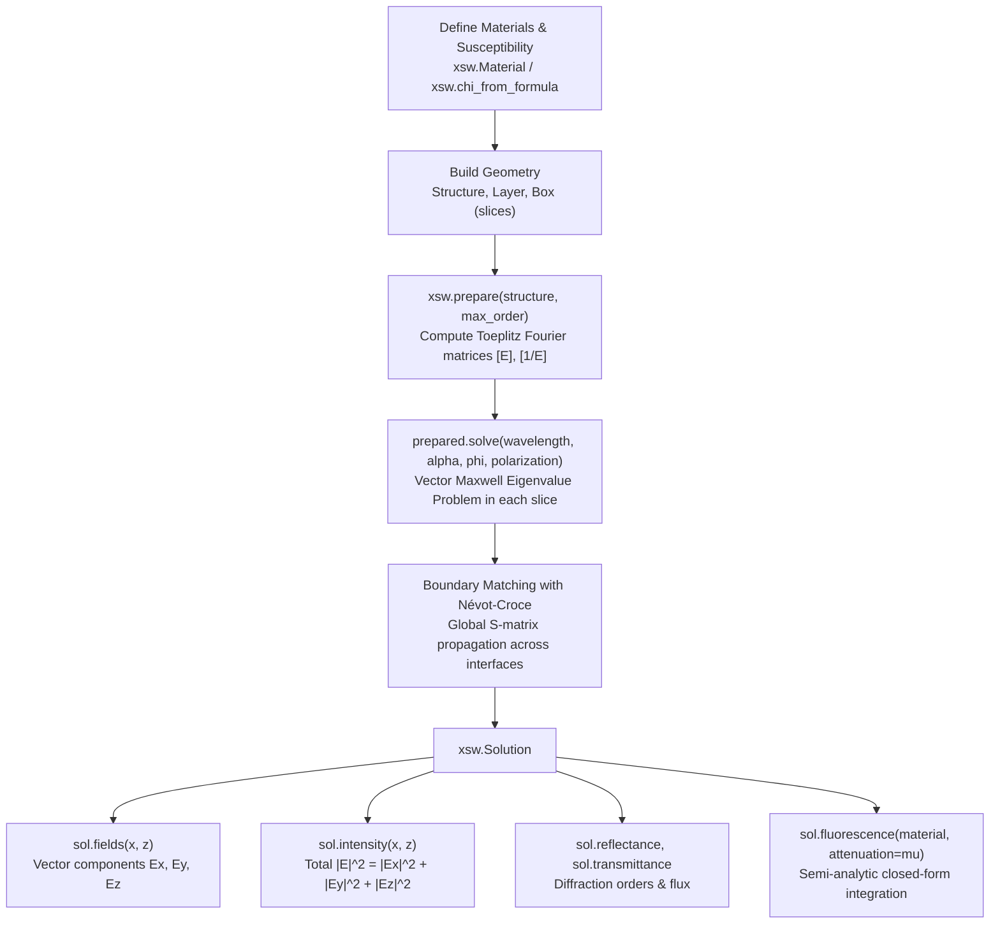
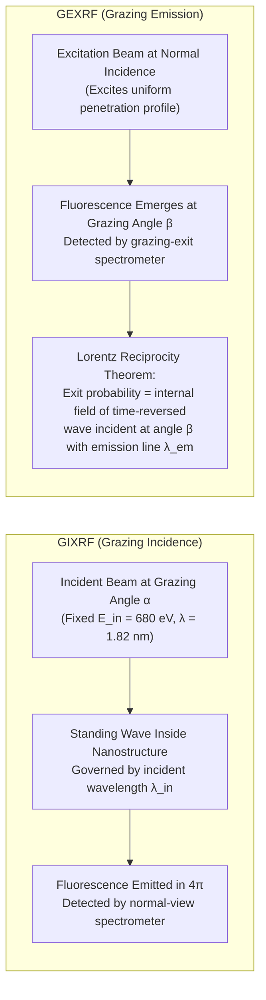

# xsw: Vector X-Ray Standing Waves & Fluorescence Solver

[]()
[]()
[]()

**`xsw`** is an efficient, full-vectorial electromagnetic simulation and reconstruction package for **X-ray Standing Waves (XSW)**, **Grazing Incidence X-ray Fluorescence (GIXRF)**, and **Grazing Emission X-ray Fluorescence (GEXRF)** in periodic nanostructures.

The sample geometry is structured along depth $z$, periodic along $x$, and continuous (translationally invariant) along $y$: $\varepsilon(x, z)$. The package solves Maxwell's equations using **Rigorous Coupled-Wave Analysis (RCWA)** with proper Fourier factorization (Li's rules), horizontal Névot–Croce interface roughness, lateral Debye–Waller sidewall roughness, and semi-analytic modal fluorescence integration.

---

## Table of Contents

- [Core Capabilities](#core-capabilities)
- [Installation](#installation)
- [How the Code Works: Theoretical & Computational Architecture](#how-the-code-works-theoretical--computational-architecture)
  - [1. Geometry & Material Representation](#1-geometry--material-representation)
  - [2. Two-Stage RCWA Solver (`prepare` $\to$ `solve`)](#2-two-stage-rcwa-solver-prepare--solve)
  - [3. Observables: Vector Fields, Intensities & Flux](#3-observables-vector-fields-intensities--flux)
  - [4. Semi-Analytic Fluorescence Integration](#4-semi-analytic-fluorescence-integration)
  - [5. Roughness Models (Debye-Waller & Névot-Croce)](#5-roughness-models-debye-waller--n%C3%A9vot-croce)
- [GIXRF vs GEXRF & Optical Reciprocity](#gixrf-vs-gexrf--optical-reciprocity)
- [Nanoscale Reconstruction & Experimental Fitting (`xsw.fit`)](#nanoscale-reconstruction--experimental-fitting-xswfit)
- [Quickstart Examples](#quickstart-examples)
  - [1. Minimal Structure & Field Calculation](#1-minimal-structure--field-calculation)
  - [2. Multi-Angle Fluorescence Scans](#2-multi-angle-fluorescence-scans)
  - [3. Experimental GIXRF Nanoscale Fitting](#3-experimental-gixrf-nanoscale-fitting)
  - [4. Instant Results Viewer (< 0.05 seconds)](#4-instant-results-viewer--005-seconds)
  - [5. Comparing GIXRF vs GEXRF](#5-comparing-gixrf-vs-gexrf)
- [Physical Conventions & Units](#physical-conventions--units)
- [Repository & Package Architecture](#repository--package-architecture)
- [Testing & Validation](#testing--validation)

---

## Core Capabilities

- **Full Vectorial Maxwell Solution**: Reconstructs all electric field components ($E_x, E_y, E_z$) and magnetic fields ($H_x, H_y, H_z$) for both $s$- and $p$-polarized illumination, including conical/oblique azimuth ($\phi \neq 0$).
- **Semi-Analytic Fluorescence Integration**: Evaluates fluorescence integrals directly from modal cross-term products in closed form—no spatial grid quadrature required.
- **Built-in Optical Constants**: Computes complex X-ray susceptibility $\chi$ from chemical formulas and mass density using local CXRO atomic scattering factor tables (`xsw.chi_from_formula`).
- **Realistic Physical Roughness**:
  - *Lateral Debye-Waller roughness* ($\sigma_{\mathrm{sw}}$) on box sidewalls.
  - *Vertical Névot-Croce roughness* ($\sigma_{\mathrm{vert}}$) on horizontal layer interfaces.
- **Experimental Fitting Engine (`xsw.fit`)**: High-performance profile reconstruction implementing Anna Andrle Configuration B (680 eV, p-pol, pitch 100.8 nm) from Anna Andrle's MS thesis and *Nanomaterials* 2021, 11, 1647.
  - Solves optimal elemental scale factors $c_{\mathrm{N}}^*, c_{\mathrm{O}}^*, c_{\mathrm{C}}^*$ analytically in closed form at each step via weighted linear least-squares.
  - Applies instrumental beamline angular divergence convolution ($\sigma_{\mathrm{div}} = 0.01^\circ$).
- **GEXRF via Optical Reciprocity**: Simulates Grazing Emission X-ray Fluorescence using the Lorentz reciprocity theorem evaluated at characteristic elemental emission lines.
- **Fast & Scalable**: Geometry precomputation caching, bounded-memory chunked scanning, configurable multi-core execution, and BLAS thread oversubscription management.

---

## Installation

Requires **Python 3.10** or newer.

```bash
# Clone the repository
git clone https://github.com/CyclolcyCC/rcwa.git
cd rcwa

# Standard user installation
python -m pip install .

# Or editable developer installation with test and plot dependencies:
python -m pip install -e ".[test,plot]"

# Verify the test suite (145 tests passing):
python -m pytest
```

Runtime dependencies are NumPy, SciPy, and threadpoolctl. Matplotlib is optional for plotting.

---

## How the Code Works: Theoretical & Computational Architecture



### 1. Geometry & Material Representation

The sample structure is stratified along $z$ and periodic along $x$:
- **`xsw.Material(chi, name, fluorescent=False, density=1.0)`**: Encapsulates complex susceptibility $\chi = \varepsilon - 1$. For passive media with $e^{-i\omega t}$, $\mathrm{Im}(\chi) > 0$.
- **`xsw.Box(x_min, x_max, material, sigma=0.0)`**: A material block spanning $[x_{\min}, x_{\max}]$ within a layer. Sidewall roughness $\sigma$ damps Fourier contrast harmonics.
- **`xsw.Layer(thickness, background=vacuum, sigma=0.0)`**: A horizontal slice of thickness $d$ containing non-overlapping boxes. Interface roughness $\sigma$ applies to its top boundary.
- **`xsw.Structure(period, substrate, substrate_sigma=0.0)`**: Unit cell of period $p$ containing stacked layers over a semi-infinite substrate ($z \ge \sum d_j$).

### 2. Two-Stage RCWA Solver (`prepare` $\to$ `solve`)

To achieve maximum performance during angular or energy scans:
1. **Geometry Preparation (`xsw.prepare`)**:
   - Expands the piecewise-constant permittivity $\varepsilon(x)$ and inverse permittivity $1/\varepsilon(x)$ into 1D Fourier series for orders $m \in [-M, M]$.
   - Constructs convolution matrices $\llbracket \varepsilon \rrbracket$ and $\llbracket 1/\varepsilon \rrbracket$ according to **Li's factorization rules** to ensure fast Fourier convergence across material discontinuities.
   - Caches Fourier matrices; snapshots geometry as immutable.
2. **Illumination Solve (`prepared.solve` or `xsw.solve`)**:
   - For a given incident wavevector $\mathbf{k}_{\mathrm{inc}}$ (defined by grazing angle $\alpha$, azimuth $\phi$, and wavelength $\lambda$), forms the coupled vector Maxwell operator:
     $$\mathbf{\Omega} = \begin{bmatrix} -k_x \llbracket \varepsilon \rrbracket^{-1} k_y & k_x \llbracket \varepsilon \rrbracket^{-1} k_x - \mathbf{I} \\ \mathbf{I} \mu - k_y \llbracket \varepsilon \rrbracket^{-1} k_y & k_y \llbracket \varepsilon \rrbracket^{-1} k_x \end{bmatrix}$$
   - Solves the eigenvalue problem in each layer for modal vertical wavevectors $k_{z,m}$ and field eigenvectors.
   - Matches boundary conditions across layer interfaces using numerically stable scattering matrix propagation, incorporating Névot–Croce roughness factors.

### 3. Observables: Vector Fields, Intensities & Flux

Given an `xsw.Solution`:
- **`solution.fields(x, z)`**: Returns complex $(E_x, E_y, E_z)$ arrays on an arbitrary 2D spatial grid.
  - Normal field $E_x$ is reconstructed from displacement $D_x / \varepsilon(x)$ to preserve exact boundary jump conditions at vertical interfaces.
- **`solution.intensity(x, z)`**: Total electric intensity:
  $$|E(x, z)|^2 = |E_x(x, z)|^2 + |E_y(x, z)|^2 + |E_z(x, z)|^2$$
- **`solution.reflectance` & `solution.transmittance`**: Poynting flux conservation:
  $$R = \sum_m R_m, \quad T = \sum_m T_m, \quad A = 1 - R - T$$

### 4. Semi-Analytic Fluorescence Integration

Fluorescence excitation is proportional to the total electric intensity inside fluorescent regions. Rather than generating a fine spatial grid and performing numerical quadrature, `xsw` integrates directly from modal cross-term amplitudes:
$$J_k = \int_{\Omega_k} |E(x, z)|^2 e^{-\mu z} \, dx \, dz$$
Because fields are expansions of modal exponentials:
$$E_c(x, z) = \sum_m \left( a_m^+ e^{i k_{z,m} z} + a_m^- e^{-i k_{z,m} z} \right) \psi_{c,m}(x)$$
The double integral splits analytically into:
1. **Lateral overlap integrals**: $\int_{x_1}^{x_2} e^{i(k_{x,m} - k_{x,n}) x} \, dx$ (evaluated in closed form).
2. **Vertical modal interference integrals**: $\int_{z_1}^{z_2} e^{i(\pm k_{z,m} \mp k_{z,n}^*) z} e^{-\mu z} \, dz$ (evaluated with stable zero-exponent limits).

This gives exact results with zero spatial discretization error in negligible computation time.

### 5. Roughness Models (Debye-Waller & Névot-Croce)

- **Sidewall Roughness (Debye-Waller)**:
  Applies to box boundaries via `Box(..., sigma=sigma_sw)`. Damps Fourier contrast harmonics by:
  $$\exp\left(-\frac{1}{2} (G_m \sigma_{\mathrm{sw}})^2\right), \quad G_m = \frac{2\pi m}{\mathrm{period}}$$
  Preserves the average material volume (zeroth Fourier harmonic) while smoothing diffraction contrast.
- **Interface Roughness (Névot-Croce)**:
  Applies to horizontal interfaces via `Layer(..., sigma=sigma_vert)` and `Structure(..., substrate_sigma=...)`. Damps modal boundary transmission matrices $V = P_{\mathrm{upper}}^{-1} P_{\mathrm{lower}}$ by:
  $$\exp\left(-\frac{1}{2} (\Delta k_z \sigma_{\mathrm{vert}})^2\right)$$
  Recovers the exact complex Fresnel amplitude factor $\exp(-2 k_{z,1} k_{z,2} \sigma^2)$ for homogeneous boundaries.

---

## GIXRF vs GEXRF & Optical Reciprocity



By the **Lorentz optical reciprocity theorem**, Grazing Emission (GEXRF) and Grazing Incidence (GIXRF) are mathematically conjugate:
- In **GIXRF**, the standing wave field is set by the fixed incident beam ($E_{\mathrm{in}} = 680\text{ eV}$, $\lambda = 1.82\text{ nm}$). Thus, all elements exhibit their primary critical-angle rises and interference peaks at similar incident angles ($\alpha \approx 2.5^\circ - 3.0^\circ$).
- In **GEXRF**, the exit field corresponds to a time-reversed plane wave at the **characteristic emission line wavelength**:
  - $\mathrm{O}\text{-}\mathrm{K}\alpha$: $524.9\text{ eV}$ ($\lambda = 2.36\text{ nm}$) $\implies \theta_c \approx 3.2^\circ$
  - $\mathrm{N}\text{-}\mathrm{K}\alpha$: $392.4\text{ eV}$ ($\lambda = 3.16\text{ nm}$) $\implies \theta_c \approx 4.0^\circ$
  - $\mathrm{C}\text{-}\mathrm{K}\alpha$: $277.0\text{ eV}$ ($\lambda = 4.48\text{ nm}$) $\implies \theta_c \approx \mathbf{6.0^\circ}$
  
Because $\mathrm{C}\text{-}\mathrm{K}\alpha$ emits at a softer energy, its critical angle $\theta_c \propto \lambda \propto 1/E$ shifts outward to $\approx 6^\circ$.

Both GIXRF and GEXRF must be compared on the **shared physical count scale** using analytical elemental scaling factors $c_N, c_O, c_C$:
- Bulk channels ($\mathrm{O}, \mathrm{N}$) reach peak counts of $\approx 0.8 - 1.05$.
- Trace contamination ($\mathrm{C}_2\mathrm{O}$, $2.5\text{ nm}$) reaches peak counts of $\approx 0.14$.

---

## Nanoscale Reconstruction & Experimental Fitting (`xsw.fit`)

The `xsw.fit` module provides an automated reconstruction pipeline replicating Anna Andrle Configuration B at $E = 680\text{ eV}$ (p-polarization) on a periodic $\mathrm{Si}_3\mathrm{N}_4$ grating:

- **10-Slice Trapezoidal Model**: Slices the trapezoid into 10 layers, including conformal $\mathrm{SiO}_2$ top cap/groove and conformal $\mathrm{C}_2\mathrm{O}$ contamination ($t_C = 2.5\text{ nm}$).
- **Analytical Scale Factor Elimination**: At every candidate geometry during optimization, optimal scale factors $c_k^*$ are computed analytically in closed form via weighted linear least-squares:
  $$c_k^* = \frac{\sum_i I_{\mathrm{exp},k}(\alpha_i) I_{\mathrm{conv},k}(\alpha_i) / \sigma_{k,i}^2}{\sum_i I_{\mathrm{conv},k}(\alpha_i)^2 / \sigma_{k,i}^2}$$
  This completely removes linear intensity scaling from the non-linear search space.
- **Instrumental Divergence**: Convolves calculated angular yield curves with a 1D Gaussian kernel ($\sigma_{\mathrm{div}} = 0.01^\circ$).
- **Simultaneous 3-Channel Residuals**:
  $$r_k(\alpha_i) = \frac{I_{\mathrm{exp},k}(\alpha_i) - c_k^* I_{\mathrm{conv},k}(\alpha_i)}{\sigma_{k,i}}, \quad \chi^2 = \sum_{k \in \{\mathrm{N}, \mathrm{O}, \mathrm{C}\}} \sum_i r_k(\alpha_i)^2$$
- **Lossless Persistence**: `FitResult.save()` and `FitResult.load()` store parameters, covariance matrices, and full forward arrays in compressed `.npz` files.

---

## Quickstart Examples

### 1. Minimal Structure & Field Calculation

```python
import numpy as np
import xsw

# 1. Define materials via CXRO susceptibility tables (680 eV, lambda = 1.8233 nm)
si = xsw.Material(xsw.chi_from_formula("Si", density=2.33, energy=680), name="Si")
nitride = xsw.Material(xsw.chi_from_formula("Si3N4", density=3.10, energy=680), name="Si3N4", fluorescent=True)

# 2. Build grating unit cell (period = 100 nm, substrate = Si)
sample = xsw.Structure(period=100.0, substrate=si)
sample.add_layer(xsw.Layer(thickness=90.0).add_box(-22.5, 22.5, nitride, sigma=1.5))

# 3. Solve vector Maxwell equations at alpha = 2.5 deg, p-polarization
sol = xsw.solve(
    sample, wavelength=1.8233,
    alpha=np.deg2rad(2.5), phi=0.0,
    polarization="p", max_order=12,
)

# 4. Extract field intensity and semi-analytic fluorescence
x = np.linspace(-50, 50, 201)
z = np.linspace(0, 90, 181)
E_sq = sol.intensity(x, z)            # (181, 201) array: |Ex|^2 + |Ey|^2 + |Ez|^2
yield_n = sol.fluorescence(nitride)   # Semi-analytic scalar yield
print(f"Reflectance: {sol.reflectance:.4f}, Fluorescence: {yield_n:.2e}")
```

### 2. Multi-Angle Fluorescence Scans

For fast scanning over angles or energies, use `xsw.prepare`:

```python
prep = xsw.prepare(sample, max_order=12)

angles = np.deg2rad(np.linspace(0.5, 10.0, 100))
yields = [
    prep.solve(alpha=a, phi=0.0, wavelength=1.8233, polarization="p").fluorescence(nitride)
    for a in angles
]
```

Or run multi-core parallel scans over 2D grids:

```python
alpha_grid = np.deg2rad(np.linspace(0.1, 5.0, 50))
phi_grid = np.deg2rad(np.linspace(-2.0, 2.0, 30))

yield_map = xsw.fluorescence_map(
    sample, alpha_grid[:, None], phi_grid[None, :],
    wavelength=1.8233, polarization="p", max_order=12, material=nitride,
    workers=4, chunk_size=16,
)
```

### 3. Experimental GIXRF Nanoscale Fitting

Run the 3-channel GIXRF profile reconstruction for Anna Andrle Configuration B:

```bash
python examples/fit_andrle_b.py
```

*Runs full optimization in ~30 seconds, computes parameter uncertainties, saves `.npz` results, and generates publication-grade single-graph and multi-panel figures in `examples/output/`.*

### 4. Instant Results Viewer (< 0.05 seconds)

View previously fitted results instantly without re-running the optimization:

```bash
python examples/plot_andrle_b.py
```

### 5. Comparing GIXRF vs GEXRF

Run optical reciprocity comparison between Grazing Incidence and Grazing Emission:

```bash
python examples/compare_gixrf_gexrf.py
```

*Generates side-by-side comparison on the shared physical count scale (`examples/output/gixrf_vs_gexrf_comparison.png`).*

---

## Physical Conventions & Units

| Quantity | Default Unit | Notes |
| :--- | :--- | :--- |
| **Lengths & coordinates** ($x, y, z$, thicknesses, pitch) | $\mathrm{nm}$ | $x$ periodic, $y$ translationally invariant, $z$ depth increasing into sample |
| **Wavelength** ($\lambda$) | $\mathrm{nm}$ | $\lambda = hc / E \approx 1239.841984 / E(\mathrm{eV})$ |
| **Photon Energy** ($E$) | $\mathrm{eV}$ | Optional alternative to `wavelength` in `solve` and `chi_from_formula` |
| **Angles** ($\alpha, \beta, \phi$) | $\mathrm{radians}$ | $\alpha$ = grazing incidence angle ($0 < \alpha \le \pi/2$), $\phi$ = azimuth ($\phi=0$ along grating lines) |
| **Permittivity & Susceptibility** | Dimensionless | $\varepsilon = 1 + \chi$. For $e^{-i\omega t}$, passive media have $\mathrm{Im}(\chi) > 0$ |
| **Roughness** ($\sigma$) | $\mathrm{nm}$ | $\sigma_{\mathrm{sw}}$ = lateral Debye-Waller sidewall; $\sigma_{\mathrm{vert}}$ = vertical Névot-Croce interface |
| **Attenuation** ($\mu$) | $\mathrm{nm}^{-1}$ | Depth exponential factor $\exp(-\mu z)$ in fluorescence integrals |
| **Diffraction Orders** | Integer | `max_order=M` includes $2M+1$ orders ($-M \le m \le M$) |

---

## Repository & Package Architecture

```
rcwa/
├── src/xsw/                    # Core Python package
│   ├── __init__.py             # Public API entry point
│   ├── core.py                 # Core solve/prepare functions and Solution class
│   ├── materials.py            # Material class and susceptibility utilities
│   ├── geometry.py             # Structure, Layer, and Box classes
│   ├── solver.py               # RCWA Maxwell eigenvalue solver & boundary matching
│   ├── observables.py          # Field reconstruction and semi-analytic fluorescence
│   ├── roughness.py            # Debye-Waller and Névot-Croce roughness kernels
│   ├── data/                   # CXRO atomic scattering factor tables (f1, f2)
│   └── fit/                    # Nanoscale profile fitting module
│       ├── data.py             # Experimental dataset loader (ExperimentData)
│       ├── geometry.py         # 10-slice trapezoid generator (build_andrle_b_sample)
│       ├── divergence.py       # Gaussian beam angular spread convolution
│       ├── objective.py        # Forward simulation & analytical scale evaluation
│       ├── optimizer.py        # SciPy least_squares optimizer & FitResult serialization
│       └── visualization.py    # Figure generators (single graph & summary panels)
├── examples/                   # Clean, minimalistic scripts
│   ├── a_Si3N4_structure.py    # Minimalist forward simulation
│   ├── fit_andrle_b.py         # Full GIXRF 3-channel profile reconstruction
│   ├── plot_andrle_b.py        # Instant results viewer (< 0.05 s)
│   └── compare_gixrf_gexrf.py  # GIXRF vs GEXRF reciprocity comparison
├── tests/                      # Automated test suite (145 tests)
├── benchmarks/                 # Reproducible performance benchmarks
└── docs/                       # Detailed theoretical derivation (formulation.md)
```

---

## Testing & Validation

The test suite thoroughly verifies:
1. **Electromagnetic Boundaries**: Tangential continuity of $E_y, H_y, E_x \varepsilon$ across material interfaces.
2. **Lossless Conservation**: $R + T = 1.0$ within numerical precision for non-absorbing gratings.
3. **Homogeneous Limits**: Exact agreement with classical Fresnel equations for both $s$- and $p$-polarizations.
4. **Semi-Analytic vs Numerical Fluorescence**: Exact equivalence between modal cross-term integration and 2D spatial grid quadrature.
5. **Experimental Reconstruction**: Dataset integrity, divergence energy conservation, closed-form analytical scale solving, and lossless save/load roundtrips.

Run the test suite at any time:
```bash
python -m pytest
```
